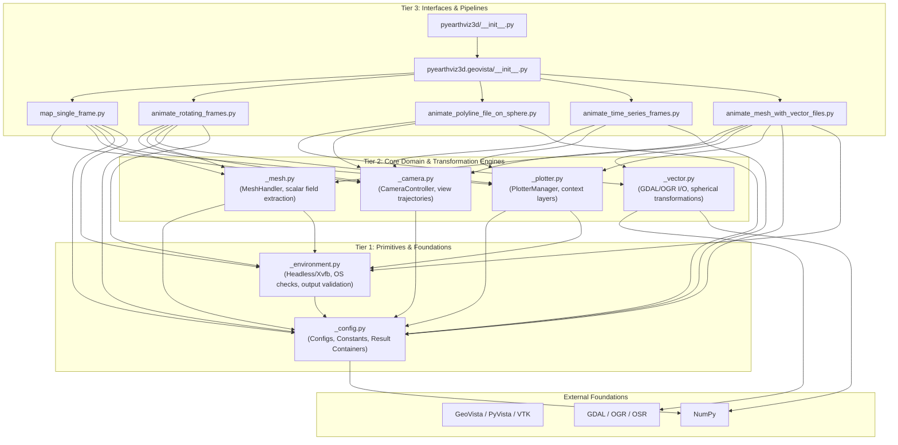

# `pyearthviz3d` Package Architecture

## 1. Overview & Architectural Scope

`pyearthviz3d` is a specialized Python library designed for 3D geospatial Earth-system visualization. It builds on top of [GeoVista](https://github.com/bjlittle/geovista) and [PyVista](https://github.com/pyvista/pyvista) to deliver high-performance spherical rendering of curvilinear/unstructured Earth science meshes, time-series state transitions, and vector GIS polyline overlays.

This architecture conforms strictly to the **Universal 3-Tier Layering Principles** defined in [`.agents/rules/code-architect.agent.md`](../.agents/rules/code-architect.agent.md):
- **Tier 1: Primitives & Foundations** (system wrappers, base constants, raw containers).
- **Tier 2: Core Domain & Transformation Engines** (algorithms, coordinate transformations, domain handlers).
- **Tier 3: Interfaces & Pipelines** (high-level orchestration, visualization runners, public facades).

---

## 2. Universal 3-Tier Layering Hierarchy



---

### Tier 1: Primitives & Foundations

The foundational tier has zero dependencies on higher-level domain or pipeline logic. It encapsulates configuration containers, system environment detection, and validation logic.

| Module | Responsibilities | Key Components & Types |
| :--- | :--- | :--- |
| [`_config.py`](../pyearthviz3d/geovista/_config.py) | Immutable constants, validation primitives, and configuration dataclasses | `VisualizationConfig`, `AnimationConfig`, `ScalarBarConfig`, `AnimationResult`, `CameraPosition`, `COORDINATE_BOUNDS`, `VALID_IMAGE_FORMATS`, `VALID_ANIMATION_FORMATS`, `DEFAULT_*` |
| [`_environment.py`](../pyearthviz3d/geovista/_environment.py) | Headless environment detection, virtual framebuffers (Xvfb), system diagnostic information | `detect_headless_environment()`, `setup_xvfb_if_needed()`, `is_running_in_notebook()`, `get_system_info()`, `validate_output_filename()` |

---

### Tier 2: Core Domain & Transformation Engines

The engine tier contains numerical algorithms, geometry transformations, and specialized handlers. Each module is focused on a single responsibility and imports only from Tier 1 and external foundational libraries (`numpy`, `geovista`, `pyvista`, `osgeo`).

| Module | Responsibilities | Key Components & Functions |
| :--- | :--- | :--- |
| [`_camera.py`](../pyearthviz3d/geovista/_camera.py) | Spherical-to-Cartesian focal point and camera position calculations, rotating camera trajectories | `CameraController`, `configure_camera()`, `configure_camera_enhanced()` |
| [`_mesh.py`](../pyearthviz3d/geovista/_mesh.py) | Valid cell index extraction, scalar field range analysis, continuous and discrete colormap registration, actor configuration | `MeshHandler`, `add_mesh_to_plotter()` |
| [`_vector.py`](../pyearthviz3d/geovista/_vector.py) | GDAL/OGR vector reading, spatial reference transformation to WGS84, variable-width attribute scaling, spherical Cartesian PolyData creation | `load_vector_geometries()`, `geometries_to_polydata()`, `normalize_vector_inputs()`, `transform_vectors_sph_to_cart()` |
| [`_plotter.py`](../pyearthviz3d/geovista/_plotter.py) | GeoPlotter instance creation with fallback strategies, geographic overlays (coastlines, graticule, textures) | `PlotterManager`, `add_geographic_context()`, `add_geographic_context_enhanced()`, `setup_geovista_plotter()` |

---

### Tier 3: Interfaces & Pipelines

The interface tier provides public orchestration workflows and convenience import facades. Modules in this tier coordinate engines from Tier 2 and foundations from Tier 1 to produce visual outputs (static image files, interactive windows, or animated videos).

| Module | Responsibilities | Primary Functionality |
| :--- | :--- | :--- |
| [`map_single_frame.py`](../pyearthviz3d/geovista/map_single_frame.py) | Single-frame static snapshot visualization pipeline | `map_single_frame(...) -> Union[bool, SingleFrameResult]` |
| [`animate_rotating_frames.py`](../pyearthviz3d/geovista/animate_rotating_frames.py) | Rotating camera globe animation pipeline | `animate_rotating_frames(...) -> Union[bool, AnimationResult]`, `create_animation_preview(...)` |
| [`animate_polyline_file_on_sphere.py`](../pyearthviz3d/geovista/animate_polyline_file_on_sphere.py) | Standalone vector polyline animation pipeline | `animate_polyline_file_on_sphere(...) -> bool` |
| [`animate_time_series_frames.py`](../pyearthviz3d/geovista/animate_time_series_frames.py) | Sequential multi-frame time-series mesh visualization pipeline | `animate_time_series_frames(...) -> bool` |
| [`animate_mesh_with_vector_files.py`](../pyearthviz3d/geovista/animate_mesh_with_vector_files.py) | Composite visualization combining mesh data and multi-layer vector GIS files with Z-ordering | `animate_mesh_with_vector_files(...) -> Union[bool, AnimationResult]`, `VectorLayerConfig` |
| [`utility.py`](../pyearthviz3d/geovista/utility.py) | Compatibility facade preserving historical import paths | Re-exports Tier 1 & Tier 2 symbols without hosting implementations |
| [`geovista/__init__.py`](../pyearthviz3d/geovista/__init__.py) | Submodule API boundary | Exposes all 5 pipelines, `VectorLayerConfig`, and `AnimationResult` |
| [`__init__.py`](../pyearthviz3d/__init__.py) | Package root API boundary | Mirrors the public interface with clean `__all__` export list |

---

## 3. Dependency Directionality & Import Matrix

The package enforces strict unidirectional dependencies from higher to lower tiers:

```
[Tier 3: Pipelines]
      │
      ▼
[Tier 2: Domain Engines]
      │
      ▼
[Tier 1: Primitives & Foundations]
      │
      ▼
[External Runtime Dependencies: NumPy, GeoVista, PyVista, GDAL]
```

### Module Cross-Import Matrix

| Source Module | `_config` | `_environment` | `_camera` | `_mesh` | `_plotter` | `_vector` |
| :--- | :---: | :---: | :---: | :---: | :---: | :---: |
| **`_config.py`** | — | ❌ | ❌ | ❌ | ❌ | ❌ |
| **`_environment.py`** | ✅ | — | ❌ | ❌ | ❌ | ❌ |
| **`_camera.py`** | ✅ | ❌ | — | ❌ | ❌ | ❌ |
| **`_mesh.py`** | ✅ | ✅ | ❌ | — | ❌ | ❌ |
| **`_plotter.py`** | ✅ | ✅ | ❌ | ❌ | — | ❌ |
| **`_vector.py`** | ❌ | ❌ | ❌ | ❌ | ❌ | — |
| **`map_single_frame.py`** | ✅ | ✅ | ✅ | ✅ | ✅ | ❌ |
| **`animate_rotating_frames.py`** | ✅ | ✅ | ✅ | ✅ | ✅ | ❌ |
| **`animate_polyline_file_on_sphere.py`**| ❌ | ❌ | ❌ | ❌ | ❌ | ✅ |
| **`animate_time_series_frames.py`** | ✅ | ❌ | ✅ | ❌ | ✅ | ❌ |
| **`animate_mesh_with_vector_files.py`** | ✅ | ✅ | ✅ | ✅ | ✅ | ✅ |

> [!IMPORTANT]
> - **Zero Circular Dependencies**: No module in Tier 1 or Tier 2 imports any pipeline module in Tier 3.
> - **Zero Cross-Engine Coupling**: Tier 2 modules (`_camera`, `_mesh`, `_plotter`, `_vector`) do not import each other. Coupling only occurs at the pipeline orchestration layer (Tier 3).

---

## 4. Key Architectural Patterns

### 4.1 Decoupled Vector Ingestion & Mesh Generation
Historically, vector data ingestion, coordinate system reprojection, variable linewidth calculation, and PyVista spherical mesh generation were embedded directly within rendering functions.

Now, [`_vector.py`](../pyearthviz3d/geovista/_vector.py) operates as a pure data engine:
1. `load_vector_geometries`: Reads GIS formats (Shapefile, GeoJSON, GeoPackage) via GDAL/OGR and reprojects coordinates to WGS84.
2. `geometries_to_polydata`: Performs direct spherical-to-Cartesian trigonometry ($\theta, \phi \to x, y, z$) on raw coordinate arrays, assembling `pv.PolyData` lines at $O(N)$ vector efficiency rather than incurring iterative actor allocations.

### 4.2 Standardized Configuration & Result Dataclasses
Configuration objects encapsulate validation and defaults:
- `VisualizationConfig`: Centralizes focus point, zoom, layers, opacity, and rendering theme. Clamps coordinates to valid terrestrial ranges ($[-180, 180]$, $[-90, 90]$).
- `AnimationConfig`: Defines frame count, playback rate, camera velocity, and file encodings.
- `ScalarBarConfig`: Configures continuous and discrete colorbar annotations, font scaling, and orientation.
- `SingleFrameResult` / `AnimationResult`: Encapsulates run status, diagnostic timing, generated file metrics, and human-readable summary reports (`get_summary()`).

### 4.3 Headless CI/CD & Cloud Rendering
Linux CI runners and cloud nodes lack physical X11 displays. [`_environment.py`](../pyearthviz3d/geovista/_environment.py) encapsulates headless detection and transparent Xvfb management (`setup_xvfb_if_needed`). Plotters automatically detect off-screen execution requirements to prevent VTK segmentation faults when running in headless containers or automated pipelines.

---

## 5. Public API Export Structure

The public API is fully synchronized across `pyearthviz3d` and `pyearthviz3d.geovista`:

```python
import pyearthviz3d as pev

# High-level pipeline functions
pev.map_single_frame(...)
pev.animate_rotating_frames(...)
pev.animate_mesh_with_vector_files(...)
pev.animate_polyline_file_on_sphere(...)
pev.animate_time_series_frames(...)

# Layer configs & result models
pev.VectorLayerConfig(...)
pev.AnimationResult(...)
```

Consistency is verified by automated test suites ([`test/test_imports.py`](../test/test_imports.py)), ensuring `pyearthviz3d.__all__ == pyearthviz3d.geovista.__all__`.
